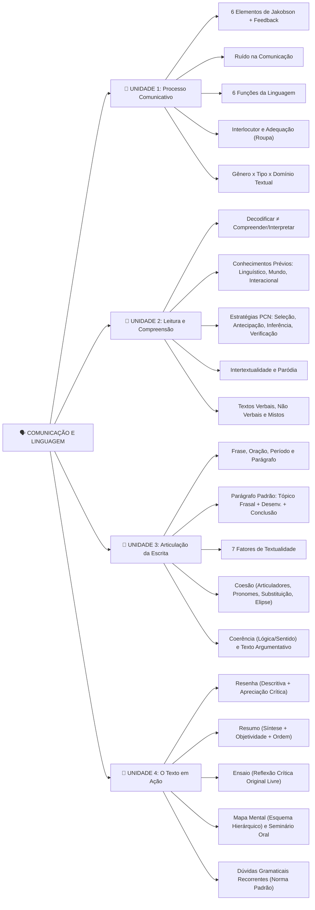
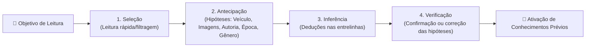

# 📚 Resumo Executivo e Mapas Mentais — Comunicação e Linguagem (Unidades 1 a 4)

**Disciplina:** Comunicação e Linguagem (Unilasalle EAD)
**Autores do E-book:** Ângela Kroetz dos Santos e Gilberto Fonseca
**Data da Prova Presencial (Bloco 1):** 05/11/2026 (20h00 às 20h15 — Sala 308, Prédio 1 LABIN)

---

## 🧠 Mapa Mental Geral da Disciplina (4 Unidades)

---

## 📌 UNIDADE 1 — O Processo da Comunicação (p. 9–34)

### 1.1 Origem da Comunicação
- **Gesto e "Grito da Natureza" (Rousseau):** Antes da palavra falada/escrita, o ser humano comunicava-se por gestos e gritos instintivos (socorro/dor).
- **Evolução da Escrita:** Pinturas rupestres (~8.000 anos, necessidade agrícola/sedentária de medir colheita e rebanho) → sinais pictóricos → alfabeto hebraico (1700–1500 a.C.) → alfabeto grego (400 a.C.) → alfabeto latino.
- **Sociedade Contemporânea:** Passou de uma perspectiva predominantemente **oral** para uma dimensão de **escrita** (redes sociais, WhatsApp, EaD), porém com textos curtos e interações virtuais.

### 1.2 Elementos da Comunicação (Jakobson + Feedback) e Funções da Linguagem
> [!IMPORTANT]
> **Tema campeão de prova!** Cada um dos 6 elementos de Roman Jakobson (baseado em Claude Shannon) corresponde a uma **Função da Linguagem**, de acordo com a ênfase da mensagem. O **Feedback** (resposta do receptor que torna o processo interacional) não estava no modelo original de Jakobson, mas fecha o ciclo comunicativo.

| Elemento da Comunicação | Conceito-Chave | Função da Linguagem Correspondente | Características e Exemplos |
| :--- | :--- | :--- | :--- |
| **Contexto (ou Referente)** | O assunto/fato da mensagem | **Função Referencial (ou Denotativa)** | Foco na informação objetiva, impessoal, 3ª pessoa. Ex.: *Notícias de jornal, textos científicos/acadêmicos*. |
| **Emissor (ou Remetente)** | Quem envia a mensagem | **Função Emotiva (ou Expressiva)** | Foco na subjetividade, sentimentos e opiniões do emissor (1ª pessoa). Ex.: *Diários, comentários opinativos, desabafos*. |
| **Receptor (ou Destinatário)** | Para quem a mensagem é enviada | **Função Apelativa (ou Conativa)** | Foco em persuadir/convencer o interlocutor (verbos no imperativo, vocativos). Ex.: *Propagandas, anúncios publicitários*. |
| **Mensagem** | O conteúdo/conjunto de informações | **Função Poética** | Foco no **como** se diz (elaboração estética, ritmo, rimas, sonoridade, conotação). Ex.: *Poemas, músicas, textos literários*. |
| **Canal** | Meio físico/virtual por onde circula | **Função Fática** | Foco em **abrir, testar/manter ou fechar** o canal de contato. Sempre breve. Ex.: *"Alô?", "Está me ouvindo?", "Até logo"*. |
| **Código** | Sistema de signos partilhado (língua) | **Função Metalinguística** | O código explicando o próprio código (a linguagem falando dela mesma). Ex.: *Dicionário, vídeo ensinando a gravar vídeo, poema sobre fazer poesia*. |

### 1.3 Ruído, Interlocutor e Adequação Linguística
- **Ruído na Comunicação:** Qualquer falha ou interferência em um dos elementos que prejudique a compreensão (ex.: dicção ruim, receptor desatento/seletivo, erro de digitação em um e-mail corporativo trocando dia "16" por "26", ambiguidade contextual).
- **Papel Ativo do Interlocutor:** O receptor **não é passivo**; ele mobiliza seu repertório para construir sentido e alterna de papel com o emissor.
- **Adequação da Linguagem ("A língua é como a roupa"):**
  - Não existe comunicação sem intenção. O bom comunicador adapta o registro (formal x informal) ao **interlocutor**, ao **gênero** e à **situação comunicativa**.
  - *Exemplos de falha de adequação cobrados em prova:*
    1. Mandar um bilhete erudito (*"Venho mui respeitosamente..."*) para um colega de infância = ir de smoking/terno e sapatos de verniz a um piquenique.
    2. Enviar e-mail corporativo para uma Universidade usando gírias (*"E aí, galera, td certo? mto legal"*).
    3. Usar *internetês* pesado (*"naum quero + tc com vc"*, *"bisc8"*) no WhatsApp com a mãe que não domina essa variedade: **adequado ao gênero (WhatsApp), mas inadequado ao interlocutor (mãe)**.

### 1.4 Gênero Textual x Tipo Textual x Domínio Discursivo (Marcuschi)
- **Gênero Textual:** Textos concretos, empíricos e **relativamente estáveis** usados no cotidiano (definidos por *Objetivo, Tema, Estrutura, Linguagem e Esfera de Circulação*). Ex.: *e-mail, notícia, reportagem, receita médica, contrato, bula, resumo, resenha, conversa de WhatsApp*.
- **Tipo Textual (Modo Textual):** Natureza linguística/estrutural da composição (sequências internas). São apenas 5: **Narração, Argumentação, Exposição, Descrição e Injunção**.
  - **Heterogeneidade Tipológica:** Um mesmo gênero textual (ex.: *reportagem*) costuma combinar vários tipos textuais (sequências narrativas, expositivas e argumentativas).
- **Domínio Discursivo (ou Textual):** A esfera da atividade humana onde os gêneros circulam. Ex.: *Domínio Jornalístico, Acadêmico/Instrucional, Jurídico, Religioso, Comercial, Saúde, Interpessoal*.

---

## 📌 UNIDADE 2 — Da Leitura à Compreensão Textual (p. 35–68)

### 2.1 Decodificação x Compreensão e os 3 Conhecimentos Prévios
- **Decodificar ≠ Compreender:** Decodificar é apenas reconhecer os sinais gráficos/letras (quem só decodifica sem compreender é considerado *analfabeto funcional*). **Interpretar** é *"localizar as pistas e sinalizações deixadas no texto pelo autor e atribuir-lhes significado"* (Guimarães, 2011), sem fantasiar ou extrapolar os limites do texto.
- **Três Tipos de Conhecimentos Prévios (mobilizados na leitura):**
  1. **Conhecimento Linguístico:** Domínio da língua, gramática, léxico e funcionamento dos gêneros.
  2. **Conhecimento de Mundo (Enciclopédico):** Bagagem cultural, histórica e vivências armazenadas na memória.
  3. **Conhecimento Interacional:** Conhecimentos partilhados entre autor e leitor sobre as intenções e convenções da interação.

### 2.2 As Estratégias de Leitura (PCNs)

### 2.3 Intertextualidade, Paródia e Textos Não Verbais
- **Intertextualidade (Bakhtin / Koch & Elias):** Todo discurso dialoga com discursos anteriores (*"nada do que falamos é novo"*). Pode ser explícita ou implícita (exige conhecimento prévio do leitor para ser percebida) e ocorre tanto em textos verbais quanto não verbais.
- **Paródia:** Recriação de uma obra já existente e consagrada com finalidade **satírica, irônica, crítica ou humorística**, subvertendo ou reconstruindo o texto original.
  - ⚠️ **Atenção à direção da paródia em prova:** O texto novo é que faz paródia do texto original consagrado (ex.: o anúncio *"Horta de Elite"* é paródia do filme *"Tropa de Elite"*, e não o inverso!).
- **Textos Não Verbais e Mistos:** Obras de arte (ex.: *Operários*, de Tarsila do Amaral — crítica à massificação/coisificação na Era Vargas), charges, tirinhas e anúncios publicitários (ex.: anúncio da *Cimento Itambé* onde pás de cimento formam árvores; ou anúncio de papel e celulose citando personagens literários que "saem da floresta" reflorestada).

---

## 📌 UNIDADE 3 — A Articulação da Escrita (p. 69–96)

### 3.1 Frase, Oração, Período e Parágrafo Padrão
- **Frase:** Enunciado de sentido completo. Pode ser **nominal** (sem verbo), **oração** (1 verbo, estruturada em *Sujeito + Verbo + Complemento*) ou **período** (mais de um verbo).
- **Equilíbrio Frasal:** Evitar tanto a **frase excessivamente longa** (um único ponto final com ideias sobrepostas que fazem o leitor perder o fio da meada) quanto **frases fragmentadas** (curtas e picotadas demais, que quebram a relação lógica).
- **Estrutura do Parágrafo Padrão:**
  $$\text{Parágrafo Padrão} = \text{Tópico Frasal (ideia-núcleo)} + \text{Desenvolvimento (ideias secundárias)} + \text{Conclusão}$$
  - **Tipos de Tópico Frasal (Garcia, 2003):**
    1. **Declaração Inicial:** Afirmação genérica/ampla que será explicada na sequência.
    2. **Definição:** Apresenta o conceito/significado de um termo logo no início.
    3. **Divisão:** Divide o tópico em partes/segmentos que serão contrastados ou explicados.

### 3.2 Uso da Vírgula (Regra de Ouro)
- **JAMAIS** separar com uma única vírgula o **Sujeito** do **Predicado (Verbo + Complemento)**.
- **Usa-se vírgula:**
  1. Para isolar **termo intercalado** entre sujeito e verbo (obrigatoriamente **duas vírgulas**, uma antes e outra depois: *"Os alunos, ontem à noite, apresentaram o seminário"*).
  2. Para enumerar termos de um **sujeito composto** (*"Ana, Carlos, Joana e Sandra..."*).
  3. Após **adjunto adverbial deslocado** para o início da frase (*"Naquela tarde, professores..."*).

### 3.3 Os 7 Fatores de Textualidade
1. **Coesão:** Articulação na **materialidade linguística** do texto (gramática, conectores, retomadas). Depende do autor.
2. **Coerência:** Articulação no **nível das ideias/sentido** (lógica, não contradição, ordem e transição). Depende da interação autor-leitor.
3. **Informatividade:** Grau de novidade/informações relevantes que fazem o texto progredir (não repetir apenas o óbvio).
4. **Intencionalidade:** Propósito do autor ao produzir o texto.
5. **Aceitabilidade:** Atitude do leitor em aceitar o texto como coerente e compreensível.
6. **Situacionalidade:** Adequação do texto ao ambiente, época e situação comunicativa.
7. **Intertextualidade:** Diálogo com outros textos prévios.

### 3.4 Mecanismos de Coesão Textual
- **Articuladores Textuais:**
  - **Preposições:** Ligam dois termos subordinando o segundo ao primeiro (*de, do, da, em, no, por, pelo, com, para*).
  - **Advérbios:** Modificam verbo, adjetivo ou oração indicando circunstância de tempo, lugar, modo ou intensidade (*aqui, lá, completamente, mais*).
  - **Conjunções (Principais Relações cobradas em prova — Figura 3.7, p. 84):**
    - **Adição:** *e, nem, também, além disso, não só... mas também*.
    - **Oposição (Adversativas):** *mas, porém, contudo, todavia, no entanto, entretanto*.
    - **Conclusão:** *logo, portanto, por isso, assim, dessa forma, por conseguinte*.
    - **Concessão:** *ainda que, embora, mesmo que, conquanto, a despeito de*.
    - **Causa:** *já que, como (no início), uma vez que, visto que, porque*.
    - **Explicação:** *porque, pois*.
    - **Condição:** *se, caso, desde que (+ subjuntivo), a não ser que*.
    - **Tempo:** *quando, enquanto, depois que, desde que (+ indicativo, sentido de "desde o momento em que"), logo que, assim que*.
    - **Conformidade:** *como, conforme, consoante, de acordo com, segundo*.
    - **Consequência:** *tanto que, a ponto de, tal que*.
    - **Finalidade:** *para, para que, a fim de que*.
    - **Proporção:** *à medida que, à proporção que*.
- **Coesão Referencial (para evitar repetição de termos — Quadro 3.3, p. 86):**
  - **Pronominalização:** Retomar um termo por pronome (*ele, os dois, o, lo, seu, esta*).
  - **Substituição Vocabular (Sinonímia/Hiperonímia):** Retomar um termo por palavra/expressão equivalente (*"Amor Líquido"* → *"o livro"*; *"o menino e a menina"* → *"as crianças"*).
  - **Elipse:** Supressão de um termo facilmente identificável pelo contexto (*"Bauman não tem receio [...]. [Ø] Mostra que..."*).

---

## 📌 UNIDADE 4 — O Texto em Ação (p. 97–121)

### 4.1 Quadro Comparativo dos Gêneros Acadêmicos

| Gênero Acadêmico | Modalidade | Características Essenciais (Como cai na prova!) |
| :--- | :--- | :--- |
| **Resenha** | Escrito | Combina **parte descritiva** (apresentação da obra) + **parte crítica** (apreciação/juízo de valor fundamentado em argumentos). Comum sobre livros, filmes e séries. |
| **Resumo** | Escrito | Exige **síntese e objetividade**. Apresenta apenas as ideias principais do texto original de forma abreviada e **respeitando a ordem cronológica** do original, **sem emitir opinião/crítica pessoal**. Usa **paráfrase** (reescrever com as próprias palavras mantendo a autoria). |
| **Ensaio** | Escrito | Texto *discursivo-argumentativo-expositivo* mais **livre de convenções formais**, voltado à reflexão crítica autoral e conclusões originais (criado por Michel de Montaigne no séc. XVI). |
| **Mapa Mental** | Escrito / Visual | *"Resumo do resumo"* em formato de **esquema hierárquico/árvore**, ligando palavras-chave a partir de um eixo central. Pode partir de um texto-base (respeitando suas relações) ou de um *brainstorming* livre. |
| **Seminário / Apresentação** | Oral (+ Slides) | Gênero oral expositivo para compartilhar pesquisa. Exige roteiro prévio, ensaio, postura, linguagem formal (sem vícios orais como *"né?", "tipo assim"*), slides com **fundo branco**, textos curtos, imagens e sem caneta laser/excesso de animações (*"menos é mais"*). |

### 4.2 Tabela Definitiva das Dúvidas Gramaticais Recorrentes (p. 117–119)
> [!WARNING]
> **Leitura obrigatória de véspera!** As questões de gramática da prova saem literalmente desta tabela do e-book:

| ❌ Forma Inadequada | ✅ Forma Correta (Norma Padrão) | Regra Rápida |
| :--- | :--- | :--- |
| *Mau entendido / Mal humor* | **Mal entendido / Mau humor** | **Mal** ≠ Bem (*bem entendido*); **Mau** ≠ Bom (*bom humor*). |
| *Fazem cinco anos* | **Faz cinco anos** | *Fazer* indicando tempo decorrido é impessoal (sempre no singular). |
| *Houveram muitos atrasos* | **Houve muitos atrasos** | *Haver* no sentido de *existir/acontecer* é impessoal (invariável). Já o verbo *existir* vai para o plural (*Existem muitas esperanças*). |
| *Para mim fazer* | **Para eu fazer** | *Mim* não conjuga verbo (não pode ser sujeito). |
| *Entre eu e você* | **Entre mim e você** | Após preposição (*entre*), usa-se pronome oblíquo (*mim, ti*). |
| *Há cinco meses atrás* | **Há cinco meses** *ou* **Cinco meses atrás** | Nunca usar *há* e *atrás* juntos (redundância/pleonasmo). |
| *Chegou a duas horas / Daqui há 5 min* | **Chegou há duas horas / Daqui a 5 min** | **Há** = passado (*faz*); **A** = futuro ou distância. |
| *Nunca lhe vi* | **Nunca o vi** | *Lhe* é objeto indireto; o verbo *ver* pede objeto direto (*o, a*). |
| *Chegou em Porto Alegre* | **Chegou a Porto Alegre** | Verbos de movimento (*ir, chegar, levar*) exigem preposição **a**. |
| *Seção de cinema* | **Sessão de cinema** | **Sessão** = tempo de evento/reunião; **Seção** = setor/divisão (*seção eleitoral*). |
| *Ela era meia transtornada* | **Ela era meio transtornada** | *Meio* (advérbio = *um pouco*) é invariável. |
| *Nada haver com você* | **Nada a ver com você** | Expressão correta é *ter a ver* (ou *nada que ver*). |
| *Um dos que chegou antes* | **Um dos que chegaram antes** | A expressão *um dos que* pede verbo no plural. |
| *Tinha chego atrasado* | **Tinha chegado atrasado** | Com *ter/haver*, usa-se particípio regular (**chegado**). |
| *Eles tem razão* | **Eles têm razão** | Plural de *tem* e *vem* leva acento circunflexo (**têm / vêm**). |
| *De encontro aos desejos (favorável)* | **Ao encontro dos desejos** | **Ao encontro de** = a favor/harmonia; **De encontro a** = contra/choque. |
| *Já é 8 horas* | **Já são 8 horas** (mas: *Já é 1h / meio-dia*) | *Ser* indicando horas concorda com o numeral. |
| *Sobre a mira do assaltante* | **Sob a mira do assaltante** | **Sob** = debaixo de; **Sobre** = em cima de / a respeito de. |
| *Estudou, mais não passou* | **Estudou, mas não passou** | **Mas** = porém (oposição); **Mais** = quantidade. |
| *Tranqüilo* | **Tranquilo** | O trema foi abolido em palavras vernáculas (só resta em nomes próprios estrangeiros como *Müller*). |
